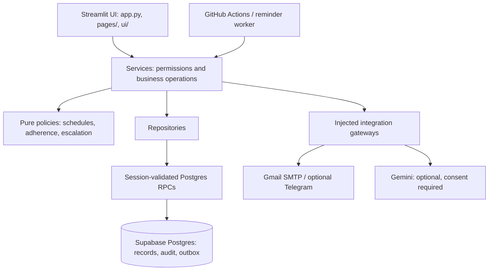

# CareCircle

**Coordinated care, with the elder in control.**

**An English and Hindi elderly care platform designed to bring medication schedules, family support, wellbeing check-ins, and doctor visits into one shared care circle.**

CareCircle helps older adults manage their daily routine while giving trusted caretakers and family members a clear way to help. The elder decides who joins, what they can see, and when information can be shared.

**Signature features:** Care Chain escalation · Accessible Elder Mode · Consent-based collaboration · Daily check-ins · Doctor Visit Brief · Reviewed AI assistance

> **Project status: specification and documentation stage.** The implementation prompt and this README are available. Application code, working demo accounts, screenshots, deployment, and test results have not yet been created in this workspace. The features, architecture, commands, and quality targets below describe the planned implementation.

[Key features](#key-features) · [Care Chain](#care-chain) · [Architecture](#architecture) · [Local development](#local-development) · [Roadmap](#roadmap)

[Read the complete implementation prompt](CareCircle_Complete_Implementation_Prompt.md) for the detailed behavior, security requirements, acceptance tests, and phase-by-phase build instructions.

<!-- Add the live CI badge only after the repository and workflow exist.
Replace OWNER and REPO before enabling it:
[](https://github.com/OWNER/REPO/actions/workflows/ci.yml)
-->

## The problem

Medication routines often depend on several people remembering different details: what is due, whether it was taken, when stock runs low, and what needs to be discussed with a doctor. Family members may want to help without knowing whether someone else is already checking in.

CareCircle's planned workflow brings those details together while preserving the elder's independence. A forgotten button tap is treated as an **unconfirmed record**, and a request for help gives a trusted person an explicit opportunity to respond.

## Key features

All features in this section are part of the planned build.

| Feature | What it offers | Need addressed |
|---|---|---|
| **Care Chain** | Timed reminders, primary and secondary care contacts, and “I'm checking on them” acknowledgements. | Clear responsibility when a dose remains unconfirmed. |
| **Accessible Elder Mode** | A calm daily screen with large Taken, Snooze, and Can't take controls; adjustable text; Hindi; and read-aloud. | A daily routine that is easier to see, understand, and operate. |
| **Elder-controlled sharing** | Separate elder, caretaker, and family roles, with category-level consent and specific edit grants. | Collaboration with boundaries chosen by the elder. |
| **Medication and schedule management** | Medicine details, weekday/time schedules, duplicate-confirmation protection, and recorded reasons for being unable to take a dose. | Consistent medication records shared with authorized people. |
| **Adherence and refill tracking** | Seven- and 30-day views, medication-level counts, streaks, a weekly heatmap, stock tracking, and refill forecasts. | Visibility into recorded routines and upcoming refill needs. |
| **Daily wellbeing check-ins** | Good / Okay / Not well responses, optional notes, configurable reminders, and gentle follow-up. | A simple way to say how the day is going. |
| **Appointments and Doctor Visit Brief** | Appointment reminders and an elder-approved summary of medication, adherence, check-ins, notes, and questions, with English/Hindi PDF export. | Better preparation for a doctor visit. |
| **Reviewed AI assistance** | Prescription extraction, natural-language and voice drafts, instruction explanations, and questions about permitted app records. | Less typing while retaining human review and control. |
| **Accountable notifications** | Email, optional Telegram, action confirmation screens, audit history, and visible delivery status. | A traceable coordination workflow with clear notification outcomes. |

## Care Chain

**Care Chain turns an unconfirmed dose into a clear, respectful handoff.**

For a normal medication scheduled at **8:00 AM**, the intended progression is:

| Time | Action, if the dose is still eligible and unconfirmed |
|---|---|
| **8:00 AM** | Remind the elder. |
| **8:15 AM** | Send a gentle follow-up to the elder. |
| **8:30 AM** | Notify the elder's authorized primary contact. |
| **9:00 AM** | Notify the authorized secondary contact. |

Messages say **“hasn't confirmed”**. A care contact can select **“I'm checking on them”**, which stops automatic escalation for that episode and lets the other authorized contacts know who accepted responsibility. It does not mark the medication taken.

### Timing by medication category

| Category | First reminder | Follow-up | Primary contact | Secondary contact |
|---|---|---|---|---|
| Normal | At due time | +15 minutes | +30 minutes | +60 minutes |
| Critical | At due time | +10 minutes | +20 minutes | +40 minutes |
| Optional | At due time | None | None | None |

The policy also accounts for:

- **Taken, skipped, cancelled, or expired doses:** stop further dose reminders.
- **Snooze:** pause reminders for 10 minutes while retaining the original due time.
- **Can't take:** record a reason and immediately queue a separate help report for the authorized primary contact, including for optional medicines.
- **Quiet hours:** defer automatic non-critical contact escalation according to the elder's settings.
- **Delayed scheduler runs:** send only the currently relevant escalation level rather than replaying a backlog of messages.
- **Consent changes:** recheck recipient access before sending.

Email action links open an accessible confirmation screen. Simply opening an email link never records a dose or accepts a care task; this prevents automated email scanners from triggering actions.

The scheduler is best effort. “Immediately queued” does not mean an email has arrived, and the app must distinguish queued, provider-accepted, uncertain, and failed deliveries.

## Designed around the elder

### A simpler daily screen

Elder Mode puts **Today's medicines**, the next due item, and **How are you today?** on one calm screen. Medication actions use large, clearly labeled controls. Advanced management remains available through separate navigation.

Accessibility targets include:

- **18–32 px adjustable text**, with a 24 px default in Elder Mode.
- **At least 48 × 48 px** touch targets.
- Text contrast of **at least 4.5:1**, with visible keyboard focus.
- **English / हिन्दी**, including validation messages and notifications.
- User-triggered **read-aloud**, with Stop and Replay controls.
- Keyboard navigation, accessible chart tables, and usable layouts at 200% zoom.

These are implementation and verification targets. Browser voice availability, especially for Hindi, varies and must have a clear fallback.

### Consent and roles

The elder grants access separately to **medications, adherence, check-ins, appointments, and doctor briefs**. New members receive no sensitive access until the elder chooses it.

| Role | Intended access |
|---|---|
| **Elder** | Manages the care circle, members, consent, medication coordination, contact policies, and brief-sharing approval. |
| **Caretaker** | Manages medications, schedules, appointments, and dose logging within the categories the elder permits. |
| **Family** | Reads consented information by default; specific edit actions require an explicit elder grant. |

Designated care contacts can receive a narrow acknowledgement permission. This does not grant medication editing. All members can change their own language, text size, and account preferences.

Consent applies to pages, charts, cached data, notifications, AI input, downloads, and shared briefs. The elder also gets an audit view of relevant changes and care actions.

## Wellbeing and doctor visits

### Daily check-ins

An elder can choose **Good**, **Okay**, or **Not well**, add a short note, or use **I'm okay**. Check-in time and the waiting window are configurable; the default follow-up window is two hours.

An unanswered check-in can notify the primary contact gently. A **Not well** response queues an explicit report to the configured authorized caretaker. Any submitted mood counts toward the response streak; the chart represents recorded responses, not a medical assessment.

### Doctor Visit Brief

The planned brief brings together a configurable reporting period, normally the last 30 days:

- Current medications, doses, and instructions.
- Adherence counts and percentages with clear denominators.
- Unconfirmed, skipped, and Can't take records and reasons.
- Check-in trends, selected family notes, and the elder's questions.
- Reporting dates, timezone, and the app-records disclaimer.

**Facts and numbers come from deterministic code.** Optional AI selects from validated factual statements; it cannot invent clinical findings. The elder approves the exact version and recipients before sharing. English and Hindi PDFs use embedded fonts and verified text shaping, with an appendix when content exceeds the readable one-page summary.

## AI assistance with review

Gemini is an optional assistant for reducing data-entry effort:

| Input or task | Intended result |
|---|---|
| Prescription photo | An editable medication draft, with uncertain fields left unresolved. |
| Typed or spoken instructions | A schedule draft to review before saving. |
| Complex instructions | A simpler explanation that preserves the original dose, timing, route, and cautions. |
| “What is scheduled today?” | An answer based on the current member's permitted app records. |
| Preparing a doctor brief | A short narrative assembled from approved facts. |

Cloud processing requires elder consent. Model output is size-limited and validated, and every change uses the same permission-checked confirmation flow as manual entry. Core medication, appointment, and check-in workflows must remain usable with AI disabled.

AI does not diagnose conditions, assess drug interactions, change prescribed treatment, record doses, change consent, or approve a brief. A typed/manual alternative remains available when voice, scanning, or the provider is unavailable.

## Screenshots

No application screenshots are available yet. These are the planned documentation slots; replace them with images captured from the running application and include descriptive alternative text.

| Planned screenshot | What it should demonstrate |
|---|---|
| Elder Mode — English | Today's medicines, large actions, and the daily check-in. |
| Elder Mode — Hindi | Natural Hindi labels, readable Devanagari text, and the text-size control. |
| Care Chain | An unconfirmed dose and the contact who acknowledged it. |
| Consent dashboard | Category-level sharing and specific family edit grants. |
| Doctor Visit Brief | A factual summary and an elder approval state. |

## Architecture

The intended design separates presentation, business rules, database access, and external integrations. UI pages never call Supabase, Gemini, SMTP, or Telegram directly.



### Technology stack

| Layer | Planned technology |
|---|---|
| Runtime and UI | Python 3.11, Streamlit |
| Persistence | Supabase Postgres, supabase-py |
| Validation and passcodes | pydantic v2, bcrypt |
| AI | Google Gemini through google-genai |
| Notifications | Gmail SMTP; optional Telegram Bot API |
| PDF export | fpdf2, uharfbuzz, bundled Latin/Devanagari fonts |
| Testing and linting | pytest, pytest-cov, ruff |
| Automation and hosting | GitHub Actions, Hugging Face Docker Spaces |

Exact dependency versions will be pinned and verified during implementation.

### Planned source layout

```text
app.py
core/                  # Configuration, models, security, permissions, i18n
services/              # Business rules and pure policy functions
repositories/          # Database operations and demo repository implementations
integrations/          # Email, Telegram, and Gemini gateways
ui/                    # Styles, reusable components, service bootstrap
pages/                 # Thin Streamlit pages
locales/               # en.json and hi.json
db/                    # schema.sql and ordered migrations
scripts/               # Reminder worker, seed script, diagnostics
tests/                 # Unit, database integration, and accessibility checks
static/fonts/          # Bundled fonts and licenses
deployment/            # Runtime and header/proxy configuration
docs/evidence/         # Actual test, accessibility, and deployment evidence
.github/workflows/     # ci.yml and reminders.yml
.streamlit/            # Configuration and secrets example
Dockerfile
requirements.txt
requirements-dev.txt
pyproject.toml
.env.example
.gitignore
SECURITY.md
ACCESSIBILITY.md
```

## Security and reliability design

The planned controls include bcrypt-hashed passcodes, verified onboarding, a 15-minute account lockout after five failed attempts, and hashed, revocable sessions with idle and absolute expiry.

Database operations use private tables and narrowly scoped RPCs that validate the session, care circle, role, consent, and resource ownership. The Supabase service-role credential stays on trusted servers. **Service-role access bypasses RLS**, so RLS alone is not the application's authorization boundary.

Dose updates, inventory adjustments, token redemption, acknowledgements, and audit entries use database transactions. Signed action tokens expire, are single-use, and are stored only as hashes. Consent is rechecked when an action is redeemed.

Notifications use a transactional outbox with unique event keys and exclusive worker claims. Ambiguous SMTP outcomes are recorded as **uncertain** instead of blindly retried. This prevents an unsupported “exactly once” claim while making delivery problems visible.

Read-heavy views use short-lived, access-scoped caching; authorization is checked before sensitive cache reads. Reminder queries use indexed active windows and batched access rather than loading all patient history.

These controls require implementation and verification. A detailed threat model will be maintained in `SECURITY.md` during development.

## Local development

> **Available after the application files are implemented.** These are the intended setup steps for the planned source layout. Running them in the current documentation-only folder will not start an application.

### 1. Prepare Python

Clone your CareCircle application repository, open its root directory, and use Python 3.11.

```bash
python -m venv .venv
```

Activate the environment on Windows PowerShell:

```powershell
.\.venv\Scripts\Activate.ps1
```

Or on macOS/Linux:

```bash
source .venv/bin/activate
```

Install the pinned dependencies once they are present:

```bash
python -m pip install -r requirements.txt -r requirements-dev.txt
```

### 2. Configure the environment

Copy `.env.example` to `.env`, or use the documented Streamlit secrets configuration. For example, on Windows:

```powershell
Copy-Item .env.example .env
```

The intended configuration contract is below. The implemented `.env.example` must document the final names, defaults, and validation rules.

| Configuration | Purpose |
|---|---|
| `DEMO_MODE` | Explicitly selects isolated synthetic data and fake integration gateways. |
| `SUPABASE_URL` | Database API URL for the configured project. |
| `SUPABASE_SERVICE_ROLE_KEY` | Server-only database credential; never exposed to the browser. |
| `APP_BASE_URL` | Public application origin used to construct confirmation links. |
| Action-signing key and key-version settings | Sign and rotate expiring email-action tokens. |
| SMTP host, port, username, app password, and sender | Gmail delivery configuration; values belong in secrets. |
| `GEMINI_API_KEY`, `GEMINI_MODEL` | Optional AI credentials and selected model. |
| Telegram opt-in and bot-token settings | Optional second notification channel. |
| Session, lockout, and worker settings | Operational limits and scheduling configuration. |

Commit examples containing placeholders only. Real secrets and health data must stay out of Git, screenshots, logs, and test fixtures.

### 3. Choose demo or production data

**Demo mode:** set `DEMO_MODE=true` once supported. The seed workflow will provide separate English/Hindi circles, synthetic histories, and elder/caretaker/family roles. Real notification delivery must remain disabled. No working demo credentials exist yet; publish clearly labeled seed-only credentials when the seed script is implemented.

**Production mode:** use a dedicated Supabase project, apply `db/schema.sql` and documented migrations, configure the required secrets, and complete verified elder onboarding. Missing configuration must produce a setup error rather than silently switching to demo data. Never run the demo seed against a real care circle.

### 4. Start the application

```bash
python -m streamlit run app.py
```

When the application exists and is running with the default local configuration, open [localhost:8501](http://localhost:8501).

## Testing and quality targets

**Target: at least 90% coverage for `core/` and `services/`, with branch measurement enabled.** This is a target, not a measured result. No tests or CI runs have been executed for an application in this workspace.

Once the test suite and dependencies exist, the intended checks are:

```bash
python -m ruff check .
python -m ruff format --check .
python -m pytest tests/unit --cov=core --cov=services --cov-branch --cov-report=term-missing --cov-report=html --cov-fail-under=90
```

Database integration tests must use a separately configured ephemeral Postgres/Supabase environment. External AI and delivery providers are mocked in unit tests; tests must never use a production care circle.

| Evaluation criterion | Planned verification |
|---|---|
| **Code Quality** | Typed, cohesive modules; enforced layering; passing lint and format checks. |
| **Security** | Every role/action pair, consent revocation, cross-circle isolation, lockout, token races, and safe link handling. |
| **Efficiency** | Bounded queries, batch access, justified indexes, safe caching, and measured query counts. |
| **Testing** | Coverage reports; timezone/DST cases; adherence edge cases; real SQL concurrency tests; mocked provider failures. |
| **Accessibility** | English/Hindi keyboard walkthroughs, contrast measurements, zoom checks, chart alternatives, and Hindi PDF inspection. |
| **Problem Alignment** | A complete elder-to-contact care journey, controlled sharing, check-ins, appointments, and approved briefs. |

The CI workflow will run lint, formatting, tests, coverage, database integration checks, and dependency auditing. Add the live CI badge only after the workflow and repository exist.

## Deployment

The deployment path is **Hugging Face Docker Spaces**, with Supabase holding persistent records and GitHub Actions running scheduled reminders.

After the Dockerfile, application, schema, and workflows are implemented:

1. Create a dedicated Supabase project and apply the schema and migrations.
2. Create a Hugging Face Space using the **Docker** SDK and upload the application source and Dockerfile.
3. Configure the Space for port **7860**, a non-root process, a health check, writable runtime directories, and the required referrer/cache headers.
4. Add database, signing, and email credentials through the Space's secret settings. Add Gemini/Telegram only when enabled.
5. Set `APP_BASE_URL` to the actual Space application's public origin, not its repository page.
6. Configure the reminder workflow's secrets separately in GitHub; Space secrets are not automatically available to Actions.
7. Run the workflow manually, verify worker health and the action-confirmation flow, then enable the five-minute schedule.
8. Test restart behavior, consent restrictions, and both languages with synthetic data before using real records.

The Hugging Face copy of the README can include this metadata at the very top:

```yaml
---
title: CareCircle
sdk: docker
app_port: 7860
---
```

The reminder entrypoint will be `scripts/run_reminders.py`, with both scheduled execution and `workflow_dispatch`. Free-tier sleeping, scheduler delays, provider quotas, and uncertain delivery must remain visible operational limitations.

## Roadmap

The implementation prompt uses six confirmation-gated phases. **No application phase is complete yet.**

| Phase | Scope | Status |
|---|---|---|
| **1 — Foundation** | Schema, configuration, authentication, onboarding, permissions, consent model, bilingual shell, text-size controls, and tests. | Planned |
| **2 — Medication workflow** | Medication CRUD, schedules, dose logging, inventory changes, adherence, and Elder Mode. | Planned |
| **3 — Reminders and collaboration** | Appointments, Care Chain, signed actions, outbox, acknowledgements, worker, and GitHub workflows. | Planned |
| **4 — Wellbeing and control** | Check-ins, consent/member dashboard, audit view, refill forecasts, and explicit help controls. | Planned |
| **5 — Assistance and briefs** | Reviewed AI/voice features, read-aloud, doctor notes/questions, approved briefs, and bilingual PDFs. | Planned |
| **6 — Verification and release** | Accessibility review, screenshots, deployment checks, documentation, final coverage, and requirement evidence. | Planned |

Each phase must deliver working code, actual test results, a short demonstration, and any remaining limitations before the next phase is authorized.

## Five-minute demo journey

Use this walkthrough once the corresponding phases are implemented. All accounts, time simulation, and delivery previews must be clearly labeled as synthetic demo data.

1. **Meet the elder:** sign in, switch English/Hindi, increase the text size, and inspect Today's medicines.
2. **Record a dose:** select Taken, repeat the action, and demonstrate that the second tap does not change stock again.
3. **Show Care Chain:** simulate an eligible unconfirmed dose and inspect the next contact event without sending a real email.
4. **Accept responsibility:** sign in as an authorized contact and select I'm checking on them.
5. **Check in:** record a mood and view the consented response history.
6. **Prepare a visit:** generate a record-based brief, approve it as the elder, and preview the Hindi or English PDF.
7. **Prove the boundary:** show that a family member without an edit grant cannot change medication or view a revoked category.

## Limitations and medical disclaimer

CareCircle is designed for coordination and recordkeeping. **It does not provide medical advice and does not replace a clinician, pharmacist, or emergency service.** For an immediate emergency, contact local emergency services directly.

An unconfirmed dose does not prove a medication was not taken, and a recorded confirmation does not prove it was swallowed. Adherence views describe app records. Notification delivery and timing cannot be guaranteed; an acknowledgement indicates that someone accepted a care task, not that an emergency response was dispatched.

AI requires review, browser speech support varies, and a PDF already downloaded outside the app cannot be recalled. Security and accessibility claims must be supported by implementation evidence before release. Data-retention and recovery procedures remain implementation deliverables; no regulatory certification is claimed.

## Contributing and documentation

Start with the [complete implementation prompt](CareCircle_Complete_Implementation_Prompt.md). Keep changes within the active phase, preserve the service/repository boundaries, and add relevant tests for new behavior. Add both English and Hindi strings with matching placeholders.

During development, maintain `SECURITY.md`, `ACCESSIBILITY.md`, and `docs/evidence/` alongside the implementation. Use synthetic data for issues, screenshots, and tests, and never include secrets or patient information in a public report.

## License

A project license has not yet been selected. Add a `LICENSE` file before distributing the implementation under open-source terms. Preserve the licenses of any bundled fonts and other third-party assets.
